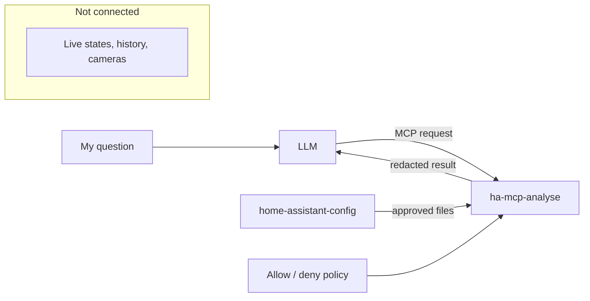
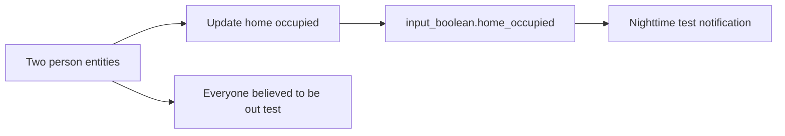

Before I change a Home Assistant automation, I often need to answer: *what else depends on this helper?* An LLM is good at tracing YAML across files. My config also describes presence, cameras, alarms, and routines, so I built a boundary around what the model can see before asking it for help.

Why two repositories? `home-assistant-config` is my actual Home Assistant config folder, tracked in Git with some files ignored; it records what Home Assistant runs. `ha-mcp-analyse` holds the read-only MCP server, which I can test and change independently to control what the LLM sees. This keeps AI tooling out of the Home Assistant config folder. The privacy boundary comes from the server's policy, not the repository split.

## Privacy first

The server uses a default-deny file policy. I choose the paths it may read; explicit denials override allows. A small policy might expose only automations and scripts:

```yaml
workspace: /path/to/home-assistant-config
allow: [automations.yaml, scripts.yaml]
deny: [secrets.yaml, .storage/**, backups/**]
```

Git-ignored files and the MCP policy solve different problems. Ignoring a file keeps it out of Git; the MCP policy decides whether the assistant can read it locally. The server also rejects paths outside the checkout, redacts sensitive values, and has no write tools or connection to Home Assistant's live API.

For example, a simplified `read_config_file` result for a made-up automation could look like this:

```yaml
path: automations.yaml
redacted: true
content: |
  alias: Example notification
  api_key: [REDACTED]
  recipient: [REDACTED_EMAIL]
```

The file path, automation name, and other non-redacted text are still visible. I use cloud LLMs, so approved tool results can leave my machine for the model provider. The allowlist limits which files can contribute to those results; it does not make the shared text private to my machine.

This small allowlist is enough for the helper traced below: its references in my checked-in YAML are in `automations.yaml`. It is not a complete view of every Home Assistant setup. My `configuration.yaml` also includes `templates.yml` and `scenes.yaml`, which this example policy cannot search. If a dependency lives in another file, I must explicitly allow that file before the assistant can find it; UI-managed configuration in `.storage` stays outside this workflow.



This still needs judgment: automation names and templates can reveal routines, and pattern-based redaction can miss unusual secrets. I review the policy and the output I share.

## What I use it for

I might ask: “Trace `input_boolean.home_occupied`. What sets it, and what reacts when it changes?” The assistant can use `find_references`, `list_automations`, and redacted file reads to build a dependency map:



The `Presence - Update home occupied` automation sets the helper when either person is home. It clears the helper only when both person states are outside `home`, `unknown`, and `unavailable`. The `Test - possible sleep when phones disconnect` automation watches for the helper to stay `off` for five minutes at night and sends a test notification. A separate `Test - everyone believed to be out` automation reads the person states directly rather than using the helper. That distinction matters before changing an away or sleep rule: what happens when a phone stops reporting, and which automation actually depends on the helper?

The answer describes *static configuration*, not what happened last night. I review any edit as a Git diff, validate the YAML, then check the configuration and behavior in Home Assistant. The LLM helps me find the dependency; I decide what the house does.

## What comes next

The read-only workflow already helps me trace dependencies. A next step could be a tool that returns a proposed diff against `home-assistant-config` without writing files. I would review and apply it through my normal Git workflow, then run Home Assistant's checks. The MCP server would remain read-only.
